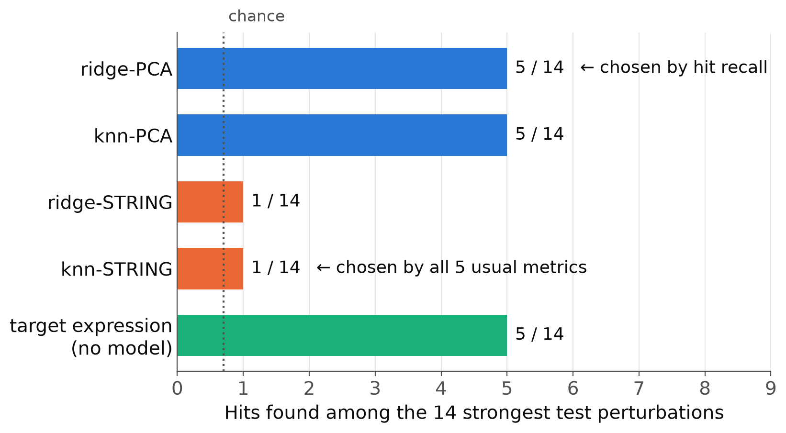
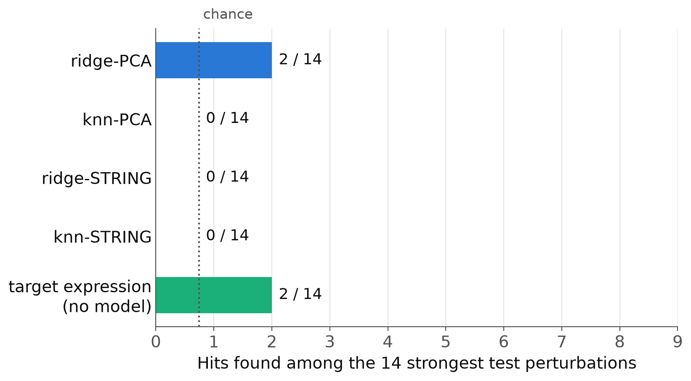
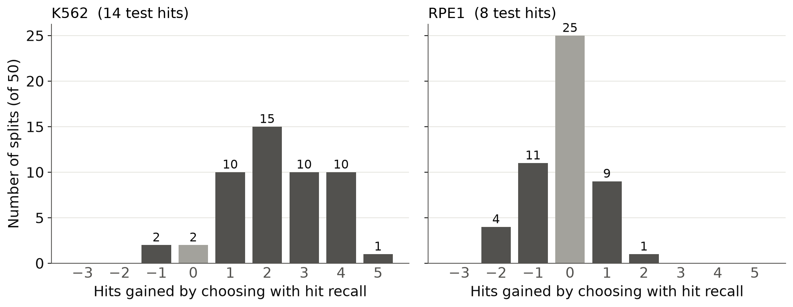
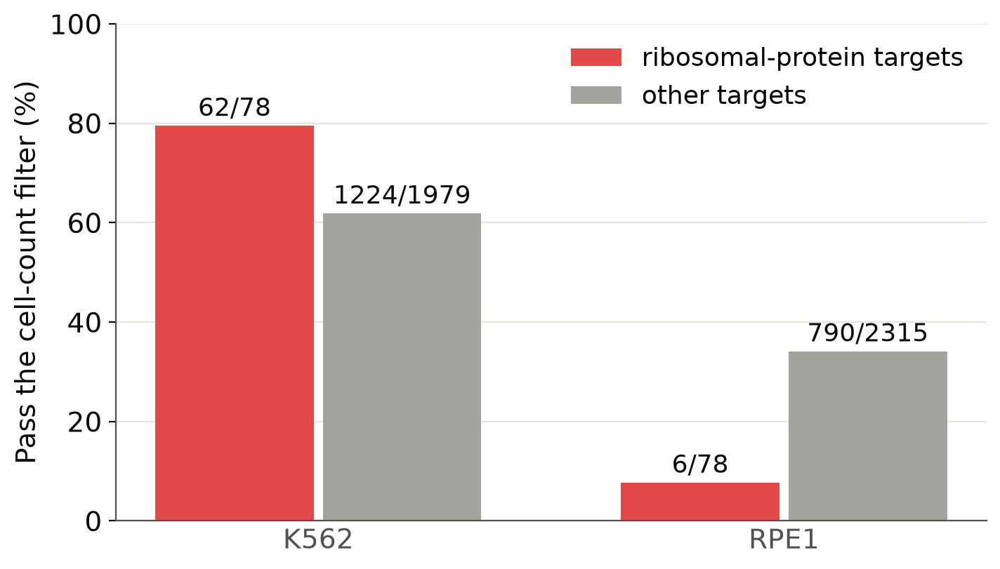

::: {.callout-note}
## In short

- **A course** on single-cell modelling, in French and English, for readers coming from machine learning.
- **A small study** asks whether the metric used to pick a perturbation model also picks good experiments. On one cell line the answer looked like "no", but the effect came largely from a single gene family that a trivial ranking finds just as well, and it did not replicate on a second line.
- **The lasting lesson is about measurement**: noisy targets and strong simple baselines. It is also why I doubt that scaling atlases alone will give a virtual cell.
:::

Everything is in a public repository, [modelling-the-cell](https://github.com/nbrosse/modelling-the-cell): the LaTeX course in both languages, the study code, the report, and the frozen analysis plan.

# Why single cell {#sec-why}

A recent project took me into "virtual cell" models: learned simulators meant to answer questions such as *what happens to this cell type if I knock down this gene?* without running the experiment. I came to the field from machine learning and applied mathematics, not biology, and the first thing I met was a paradox.

Single-cell biology has done what deep learning usually asks for. CZ CELLxGENE aggregates on the order of a hundred million cells [@czi2025cellxgene], chemical screens such as Tahoe-100M add another hundred million [@zhang2025tahoe], and foundation models such as Geneformer and scGPT were pretrained on tens of millions of transcriptomes [@theodoris2023geneformer; @cui2024scgpt]. Yet in 2025, a careful evaluation showed that these models, and the specialised deep perturbation models, did not outperform simple linear baselines at predicting the effect of a genetic perturbation, on the tasks tested [@ahlmann2025linear]. Other groups found simple controls and representations hard to beat as well [@wong2025simplecontrols; @bendidi2024pca], and a lively debate followed about whether the models are weak or the metrics are blind [@miller2026calibrated; @mejia2025diversity; @vinastorne2025systema].

I wanted to understand that paradox properly, which meant learning the field from the measurement up. This post gathers what came out of that effort, in three parts: a course (@sec-course), a small study testing one specific question (@sec-study), and an attempt to answer the larger question of whether scale will eventually win here as it did elsewhere (@sec-scaling).

# A course, in French and English {#sec-course}

The course was written largely with an AI assistant, under my direction and with my review. I am sharing it because it may help others coming to the field from machine learning. It exists in French and English.

The course is organised around one target that every model in the field approximates in some way,

$$
p\big(X \mid \mathrm{do}(a),\, c,\, d,\, t\big),
$$

the distribution of a cell's count profile $X$ when we intervene to set $a$ (the $\mathrm{do}$ operator of causal inference, as opposed to merely observing it), in a context $c$ (cell type, donor, cell line), at dose $d$ and time $t$. Three levels of capability are often conflated under "cell model": *representing* observed states, *predicting* the response to an intervention, and *deciding* which experiment to run next. Each level presupposes the previous one but does not follow from it. A good atlas embedding says nothing in general about interventions.

The twelve chapters follow that ladder:

| Theme | Chapters |
|---|---|
| Foundations | 1. From the atlas to the virtual cell · 2. Biology and measurement, from DNA to the UMI count · 3. Count statistics and the analysis pipeline |
| Representing | 4. Latent representation models (PCA, scVI and relatives) · 5. Foundation models and tokenisation |
| Predicting | 6. Perturbation data · 7. Perturbation prediction (scGen, CPA, GEARS, optimal transport, flow matching) · 8. Time and dynamics · 9. Cell imaging and the image–transcriptome link |
| Deciding | 10. Evaluating a perturbation model · 11. Closed loop: active learning and experimental design · 12. Open questions and perspectives |

Three appendices give a machine learning refresher, answers to the self-assessment questions, and a glossary. The representation, foundation-model and prediction chapters end by placing their models along the same four choices: the likelihood (Gaussian on log counts, negative binomial, categorical on tokens, none), the working space (genes, latent, tokens, image features), the conditioning (one-hot, gene embedding, knowledge graph), and how control and treated cells are coupled when the measurement destroys the cell (mean shift, latent translation, optimal transport, flow). Reading the literature through those four choices makes the field far less disorderly than it first looks.

- Course in English: [course-en.pdf](https://github.com/nbrosse/modelling-the-cell/releases/latest/download/course-en.pdf)
- Cours en français : [course-fr.pdf](https://github.com/nbrosse/modelling-the-cell/releases/latest/download/course-fr.pdf)
- LaTeX sources: [course/](https://github.com/nbrosse/modelling-the-cell/tree/main/course)

Chapter 10, on evaluation, is where the course turned into a question I could test.

# A small study: does the benchmark choose good experiments? {#sec-study}

## The question

Most of the debate on perturbation benchmarks is about *calibration*: does a metric separate an informative predictor from a trivial one, such as predicting the average effect for every gene? That matters, and recent work has made real progress on it [@miller2026calibrated; @mejia2025diversity]. But a benchmark has a second role that calibration does not address.

Picture a lab with budget for 20 experiments among 1,000 candidate perturbations. It trains several models that predict the effect of each perturbation, keeps the one with the best validation score, and runs the 20 perturbations that this model ranks as strongest. The benchmark metric has quietly become part of a decision policy: it decides which experiments get run. Nothing guarantees that the model with the lowest prediction error is the one that picks the best experiments.

So the study asks: when a predictor is chosen with a usual metric, how many of the truly strongest perturbations does it recover, compared with choosing it by that recovery rate directly? The unit of the answer is *hits lost*.

## Setting

The data are the two genome-scale CRISPRi Perturb-seq screens of essential genes from @replogle2022perturbseq, in the harmonised scPerturb release [@peidli2024scperturb]. In a Perturb-seq screen, each cell receives a guide RNA that reduces the expression of one gene (a *knockdown*, here by CRISPR interference, CRISPRi), and both the guide and the cell's transcriptome, the expression level of every gene, are read. Both screens target *essential* genes, those a cell needs to survive or divide. K562, a leukaemia line, is the discovery dataset; RPE1, a non-cancerous epithelial line, is the replication.

| | K562 (discovery) | RPE1 (replication) |
|---|---|---|
| Cells measured | 310,385 | 247,914 |
| Candidate perturbations | 1,117 | 631 |
| Train / validation / test | 558 / 279 / 280 | 315 / 158 / 157 |
| Test hits at $k$ = 5 % (defined below) | 14 | 8 |

**The task** is to predict the mean effect of knocking down a gene *never seen in training*, as a vector $\Delta_p$ of log-expression changes over 2,000 genes. The knocked-down gene itself is removed from every score, so that scores reflect the downstream response and not the efficiency of the knockdown.

**The predictors** are deliberately simple, because the point is to compare evaluation rules on models whose behaviour can be understood. Two constant baselines, *control* (no effect) and *mean* (the average training effect), cannot tell candidates apart. Four predictors, two learners times two representations, map a 64-dimensional representation of the target gene to its effect, with either ridge regression or nearest neighbours (the mean effect of the 20 most similar training targets):

- **PCA**, learned from the responses: each gene is embedded by how its expression moves across the training perturbations, a signature that even a never-targeted gene has.
- **STRING**, from prior knowledge: a spectral embedding of the STRING protein-association graph [@szklarczyk2023string], restricted to its experimental and database channels; the co-expression and text-mining channels are dropped because they could encode Perturb-seq results.

**The usual metrics** are five: Pearson correlation and MSE on raw expression, Pearson correlation on the effect $\Delta$, MSE on the 50 genes the perturbation changes most, and a discrimination score (can the prediction identify which perturbation produced a profile?).

**The decision metric** is hit recall at $k$. The hits are the $k$ candidates with the largest transcriptional effect. A model ranks candidates by the size of its predicted effect, $\lVert\tilde\Delta_p\rVert^2$, and its hit recall is the share of true hits in its top $k$. At $k$ = 5 % of the 280 K562 test candidates, there are 14 hits, and a random choice finds 0.7 of them on average.

::: {.callout-note collapse="true"}
## Measuring "strongest" without the winner's curse

The natural measure of a perturbation's strength is $\lVert\Delta_p\rVert^2$, but only a noisy estimate $\hat\Delta_p = \Delta_p + \varepsilon_p$ is observed, and

$$
\mathbb{E}\,\lVert\hat\Delta_p\rVert^2 = \lVert\Delta_p\rVert^2 + \operatorname{tr}\operatorname{Var}(\varepsilon_p).
$$

The noise term is larger for perturbations measured on fewer cells, so ranking by the naive norm would push poorly measured perturbations up. The study instead splits the sequencing batches (GEM groups, each with its own control cells) into two disjoint units $A$ and $B$ and uses the cross-fitted amplitude

$$
\mathrm{amp}(p) = \big\langle \hat\Delta_p^A, \hat\Delta_p^B \big\rangle,
$$

whose expectation is $\lVert\Delta_p\rVert^2$ when the two errors are independent and centred. The controls must be split too: if both units shared the same control cells, the bias would come back through the shared control noise. After log-normalisation, the unbiasedness is only approximate; on the pooled data the naive and cross-fitted rankings agree closely (Spearman 0.98), and the correction matters mostly at the margin.
:::

**The protocol.** I fixed the plan before looking at K562, and wrote down my predictions for RPE1 before downloading it ([plan](https://github.com/nbrosse/modelling-the-cell/blob/main/report/framing.md)).

## On K562, the usual metrics pick a model that barely beats chance

The five usual metrics agree with each other. On validation, they all choose knn-STRING, which is also the best predictor on every usual test metric. On test, it puts 1 of the 14 hits in its top 14, against 0.7 expected by chance. Hit recall on validation chooses ridge-PCA instead, which finds 5 of 14, the best test value of all predictors (@fig-k562-hits). Choosing with hit recall would have found 4 more hits.

{#fig-k562-hits fig-alt="Bar chart: ridge-PCA and knn-PCA find 5 of 14 hits, ridge-STRING and knn-STRING 1 of 14, and the target-expression ranking 5 of 14; chance is 0.7. ridge-PCA is the choice of hit recall, knn-STRING the choice of all five usual metrics."}

The STRING predictors are better at predicting the effects and at recognising perturbations; the PCA predictors are far better at finding the strongest ones. One reason the metrics can disagree with the decision is theoretical: a correlation ignores scale, $\operatorname{corr}(a x, y) = \operatorname{corr}(x, y)$ for $a > 0$, while the decision ranks candidates by the *size* of the predicted effect. A model can get every response's direction right and its size wrong, and still score well on Pearson on $\Delta$. That cannot be the whole story here, since the MSE metrics, which do see scale, chose the same predictor.

The raw-expression metrics are worse still. Every predictor, including the one that predicts no effect at all, scores between 0.992 and 0.994 in Pearson correlation on expression. Most genes keep their level after a knockdown, so getting the baseline transcriptome right is enough for a near-perfect score.

Is the four-hit gap robust? The direction is, by a rule I set after seeing the K562 result, so this check is post hoc on K562. Over 50 further random splits of the perturbations, with everything refitted and reselected each time, hit recall always picks a PCA predictor, the usual metrics always pick a STRING predictor, and the gap is positive in 92 % of splits, about 2 hits out of 14 on average (@fig-resplits, left panel). But on the main split, the half-sampling sensitivity range of the gap reaches zero, so it does not meet the criterion I had frozen in advance.

::: {.callout-note collapse="true"}
## What the sensitivity ranges are, and are not

The uncertainty of the model choice is estimated by half-sampling: 1,000 times, half of the validation perturbations are drawn and every choice is redone, and half of the test perturbations are drawn independently, with the hits redefined within that half. At k = 5 % on K562, each half holds about 7 hits instead of 14. The resulting 2.5–97.5 % ranges describe the variability of a smaller, harder selection problem; they are sensitivity ranges, not guaranteed confidence intervals, and they ignore both the noise of the training set and the noise in the hits themselves. The 50 repeated splits reuse the same perturbations, so they are a robustness check, not independent replications.
:::

## The twist: ribosomal proteins

The analyses in this section were added after the first K562 results, prompted by an adversarial review; they are exploratory. When a result looks this clean, it is worth asking *which* hits the winning model finds. Here the answer is striking: all 5 hits of ridge-PCA target ribosomal proteins (the RPL and RPS genes, which encode parts of the ribosome, the cell's protein factory). Five of the 14 test hits are ribosomal-protein knockdowns, out of 15 ribosomal-protein candidates in the test set, and ridge-PCA's top 14 holds 13 of them.

Knocking down a ribosomal protein can disturb many processes at once and produce a large transcriptional response; a biologist would call these hits expected. And a model is not needed to find them. Ranking the test targets by a single number known before any experiment, their baseline expression in control cells, also finds 5 of the 14 hits, as many as ridge-PCA (the green bar in @fig-k562-hits). Ribosomal proteins are among the most highly expressed genes in the cell, which likely explains much of the match. I call such a model-free ranking a *prior*, in the everyday sense of knowledge available before the experiment, not a Bayesian prior.

Remove the ribosomal-protein targets, and the picture changes (@fig-k562-no-rp). At k = 5 %, no advantage over chance is detected: ridge-PCA is numerically above chance (2 hits, 0.143 against 0.053) but not significantly (Monte-Carlo p = 0.16), the other models find none, and the gap between selection rules is zero. The predictors do rise above chance for $k \geq$ 10–15 %, so there is some signal in them, but not at the top of the ranking, which is where a lab with a small budget operates.

{#fig-k562-no-rp fig-alt="Bar chart on the same scale: ridge-PCA finds 2 of 14 hits, the other three predictors 0, and the target-expression ranking 2; chance is 0.74."}

So the K562 result says something narrower than it first seemed. The usual metrics and hit recall do disagree, and the disagreement costs hits. But the rule that finds more hits does so, in large part, by exploiting a family of genes that a trivial prior already ranks first. The added value of the model for this decision is not shown.

## RPE1: the gap does not replicate

The RPE1 predictions were written down before its data were downloaded. The first, that the usual metrics and hit recall would again disagree, failed. On the main split, all five usual metrics *and* hit recall choose the same predictor, knn-STRING, and the gap is zero. Over 50 re-splits the mean gap is −0.02, positive in only 18–20 % of splits and negative in 26–30 % (@fig-resplits, right panel).

{#fig-resplits .column-body-outset fig-alt="Two bar charts of the number of splits by hits gained. K562: most splits gain 1 to 4 hits, 2 splits gain none and 2 lose one. RPE1: 25 splits gain nothing, 15 lose up to two hits, 10 gain up to two."}

What did replicate is the weaker, more useful finding: the target-expression prior again matches or beats the selected model. It finds 2 of the 8 test hits, while knn-STRING, the choice of every metric, finds 1.6 (a fractional count from tie-aware expected recall). One predictor, ridge-STRING, is clearly above chance on RPE1 (3 of 8, one-sided p = 0.005, uncorrected for the four predictors), though no selection rule picked it on validation: a small point in favour of injected biological knowledge.

Why the difference between the two lines? One observation stands out (@fig-rp-filter). A perturbation is a candidate only if it has at least 20 cells in each of four batch folds. On K562, 62 of the 78 ribosomal-protein knockdowns pass that filter; on RPE1, only 6 do, and a single one lands in the test set. A plausible reading is that knocking down a ribosomal protein harms RPE1 cells more, so fewer of them are observed, and the quality filter removes almost all of the family that drove the K562 result. Hits on RPE1 also have *fewer* cells than non-hits (medians 110 against 154), the reverse of K562. This is a post hoc hypothesis: I did not test whether the filter causes the change of verdict, and fewer cells do not prove cell death.

{#fig-rp-filter fig-alt="Grouped bar chart. K562: 62 of 78 ribosomal-protein perturbations and 1,224 of 1,979 others pass the filter. RPE1: only 6 of 78 ribosomal-protein perturbations and 790 of 2,315 others pass."}

The general point outlives the specific mechanism. When inclusion in a benchmark depends on the biology of the perturbation, the benchmark is not a sample of the interventions one would like to choose among. Filtering and cell survival are part of the learning problem.

## The hits themselves are noisy

One last measurement puts all the gaps above in perspective. Splitting the cells of each perturbation into two fully independent halves and computing the top 5 % on each, the two hit lists overlap by only 79 % on K562 and 75 % on RPE1, a conservative estimate since each list uses half of the data. About one hit in four or five changes between two measurements of the same experiment. The differences between models discussed above, a few hits out of 14, are of the same order. The two quantities are not directly comparable, so this does not show that the gap is noise, but it calls for caution.

The same holds for the effect profiles: two independent halves of the same experiment correlate at only 0.48 on $\Delta$ on K562 (0.55 on RPE1). The best model reaches 0.37. That reference is pessimistic, since each half uses only part of the cells, but it shows how noisy the targets themselves are. It is a yardstick, not an upper bound: a model that estimated the true effect well could beat it.

Noise also bites on the selection side. On RPE1, with about 8 hits in validation, choosing a model by hit recall partly follows noise: across 50 splits, it picks each of the four learners between 14 % and 36 % of the time, and it loses a little on average. A metric aligned with the decision is not enough; it must also be stable enough to select with.

## What the study says, and what it does not

It says that, on these two screens and with these simple predictors:

- the usual metrics agree with each other, and on K562 they choose a predictor that is nearly useless for picking the strongest perturbations;
- a decision metric can choose differently, but its advantage on K562 is matched by a one-number prior, and it vanishes on RPE1;
- the hits and the choice of model are both uncertain enough that a benchmark should measure their stability, not assume it.

It does not say that hit recall is a better metric in general, that deep or foundation models would behave the same way, or that a large transcriptional effect is the right definition of an interesting perturbation. It is two cell lines from one study, essential genes only, small hit sets, and effectively two families of predictors.

The practical recommendations are modest. A perturbation benchmark that is meant to guide experiments should report a decision metric at the $k$ matching the experimental budget, compare models against priors that need no model (target expression, membership of known essential programmes), and not only against chance, size its validation set so that model selection is stable, and track which perturbations its filters drop.

The [report](https://github.com/nbrosse/modelling-the-cell/releases/latest/download/report.pdf) has the full methods, every pre-specified criterion with its verdict, and the leakage precautions. The [code](https://github.com/nbrosse/modelling-the-cell/tree/main/study) reproduces every result in the report's tables and figures from the public data.

# Will scale fix this? {#sec-scaling}

The study is small, but it sharpens the question I started from. Sutton's "bitter lesson" says that general methods exploiting computation eventually beat methods built on human knowledge [@sutton2019bitter]. It has been borne out in language, in protein structure [@jumper2021alphafold], in weather forecasting [@lam2023graphcast]. Why not, so far, in single cell?

My answer is that the bitter lesson carries an assumption that is easy to forget: the signal must already be in the data. Looking at the fields where scaling succeeded, I count five conditions they met. Single cell currently meets few of them.

**1. The pretraining objective is the task, or close to it.** Predicting the next token already is generating text. A weather model predicts the state at $t$ + 6 h from the state at $t$, with forty years of reanalysis (past observations assimilated into a consistent physical record) providing free input–output pairs. AlphaFold is supervised directly on structures. Single-cell foundation models, by contrast, are pretrained to reconstruct masked genes in observational atlases, while the task that matters is interventional: what happens if I perturb this gene? Learning $p(X)$ on resting cells does not identify causal effects. Atlases are the climatology of the cell, and climatology is not forecasting.

**2. The effective data size is large, not just the raw volume.** We count cells in the hundreds of millions, but the cells of one condition are replicates of each other. For perturbation prediction the statistical unit is the (perturbation, context) pair. In this study, after keeping perturbations measured on enough cells, the real $n$ was 1,117 on K562 and 631 on RPE1, in two essential-gene screens and exactly two contexts.

**3. The target is measured well above the noise.** A crystal structure in the Protein Data Bank (PDB) is accurate to 1–2 Å, well below the differences of interest. In single-cell RNA sequencing, each measurement samples a small fraction of a cell's transcripts, with batch effects on top. The study measured how much room this leaves: independent halves of the same experiment agree at 0.48 on the effect profile, and their hit lists overlap by about three quarters. When the targets are this noisy and a mean predictor is not far behind the best models, small differences between models are hard to resolve. I suspect this explains part of why deep models did not beat linear baselines [@ahlmann2025linear].

**4. A benchmark that does not lie, judged blind against a strong baseline.** Protein structure prediction was judged in CASP, a blind competition; weather models are compared on WeatherBench against the operational physics-based model of the European weather centre (ECMWF), a formidable baseline. Progress there was visible and hard to game. In single cell, raw-expression metrics saturate around 0.99 for a model that predicts nothing, and the first Virtual Cell Challenge [@roohani2025vcc] ended in a debate on metrics that a mean prediction can satisfy [@arc2025vccwrapup; @chu2025vccshenanigans]. The study adds one more failure mode: the usual metrics can choose a model that does no better than a single number known before any experiment. Without a good benchmark, real progress would go unseen if it happened.

**5. A stationary system, with structure to exploit.** The physics of the atmosphere is the same everywhere, on a sphere with known symmetries. Proteins have 3D geometry, hence equivariant architectures. Language is compositional. The cell changes with type, donor, protocol and state, and we know hardly one symmetry, the permutation of genes; Geneformer even has to invent an order, by ranking genes by expression. And the questions asked are extrapolative: an unseen perturbation, often in an unseen context. The RPE1 replication is a small illustration: a conclusion drawn on one cell line did not hold on the next, where even the candidate population differed.

Two caveats keep this from being a story of scale versus no scale. Time-series forecasting, the closest analogue to single cell with its heterogeneous series and no shared semantics, is not a clear success of scale: a linear model beat the transformers of the time [@zeng2023dlinear], and today's foundation models [@ansari2024chronos] bring convenient zero-shot forecasts; in my reading, their gains over well-tuned statistical baselines are modest. And AlphaFold is not a victory of raw scale either: it relies on a heavily domain-informed architecture and fifty years of the PDB, and its successes are concentrated where those data are dense; dynamics and the effects of single mutations remain much harder.

In the fields above, simple methods won until the condition on the data was met. The current finding in single cell does not show that scale will fail; it shows that the conditions are not met yet. Which of them can be?

**What plays for.** Biology can generate its data on demand. AlphaFold could not order new structures; a lab can run new Perturb-seq screens, and a closed loop of model and experiment is an advantage the PDB never had. Interventional datasets are growing quickly, and what matters is their diversity of contexts more than their number of cells. And prior knowledge may help: on RPE1, the only predictor clearly above chance used a protein-association graph, though on K562 the same predictors were near chance at the top.

**What plays against.** The noise ceiling is a limit of the measurement, not of the model: more cells per condition, more molecules per cell and other modalities would raise it more surely than a bigger network. The space of perturbations, contexts, doses and times is combinatorially huge, and data cover little of it. And evaluations find that single-cell foundation models often do no better than simple baselines on cell-type annotation, clustering and integration, fine-tuned [@boiarsky2023deepdive] or zero-shot [@kedzierska2025zeroshot], and that more observational pretraining does not reliably help, consistent with the first condition: more climatology does not give forecasts.

So I do not expect a generalist virtual cell from scaling up atlases. I expect narrower successes: transfer of perturbation effects between close contexts in heavily measured systems, trained on diverse interventional data, judged with decision-relevant metrics against strong priors, and fed by experiments in a loop. The likely path looks more like weather, with input–output pairs in bulk plus knowledge of the system, than like language models.

Before betting on scale for a given problem, I would now ask three questions:

1. What is the reproducibility ceiling of the measurement?
2. How many independent conditions, not cells, are there?
3. Does the benchmark show progress against a strong baseline, such as the expression level of the targeted gene?

All three can be answered on public screens before building a new model. The study above is one way of doing it.

# Code and materials {#sec-materials}

The repository [modelling-the-cell](https://github.com/nbrosse/modelling-the-cell) contains:

- `course/`: the course in French and English (LaTeX), with a shared bibliography of about 170 references;
- `report/`: the study report, the analysis plan frozen before the analysis, and the detailed results with every number traced to a script;
- `study/`: the Python code of the study (uv, tested), which downloads the public data and reproduces every figure.

Text and figures are under CC BY 4.0, code under MIT.
